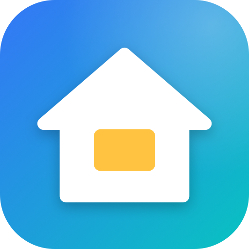
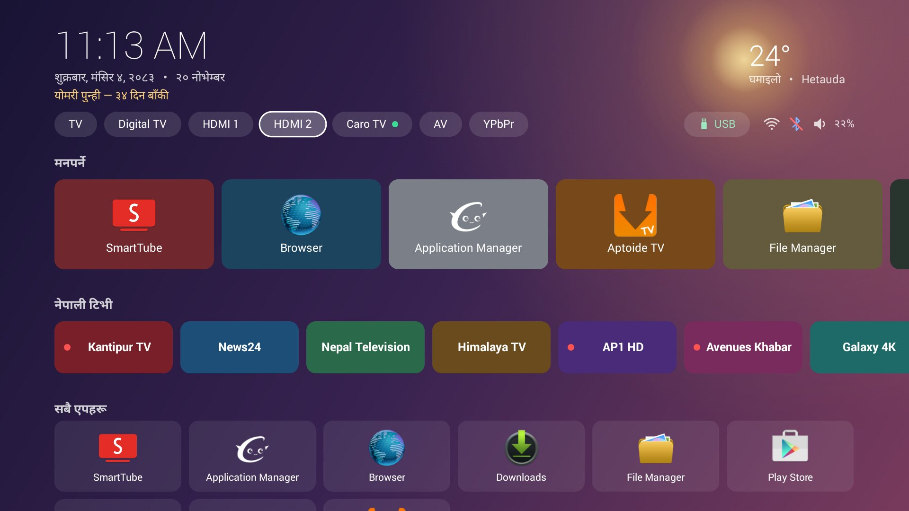

# TV Ghar

A clean home screen for old Android TVs, with the Nepali date, festivals, weather and a phone remote.

Many budget smart TVs still run Android 4.4 to 7 and will never get an update. Their home screens are
cluttered and their built-in YouTube app no longer works. TV Ghar replaces the home screen with a simple
one that is driven entirely by the TV remote. It needs no root and removes nothing from the TV.

*Ghar* (घर) means home: a home for your TV.



<sub>TV Ghar in Nepali on a WEGA TV running Android 4.4.4.</sub>

## What it does

- **Clock and dates.** The time, the English date and the Bikram Sambat date, with the next Nepali festival.
- **Patro.** A Nepali calendar, one month at a time, with English dates, the tithi of every day, Saturdays
  and festivals marked.
  Open it from the date under the clock or from *Patro* in the footer.
- **Weather.** Temperature and conditions for a city you choose (Kathmandu to start with), with a soft sun,
  moon, cloud, rain or snow drawn behind it. OK on the weather shows the next five days.
- **Volume, USB, Bluetooth.** The volume level, a USB button while a drive is plugged in, and icons for
  Wi-Fi (connected or not), Bluetooth (on or off) and a speaker or headphones on the audio socket, each
  shown only where the TV has it and can tell.
- **Nepali TV.** A row of Nepali broadcasters' own official YouTube channels, opened in SmartTube: the live
  stream when the channel is on air (a red dot marks those), its programmes otherwise. Nothing is rebroadcast.
- **TV inputs** (experimental). On TVs with an MStar board, buttons for TV, HDMI 1-3 and AV.
- **Favourites.** A row of large tiles for the apps you pick, in your order.
- **All apps, most used first.** Apps you open often rise to the top.
- **Wallpapers.** Seven hand-picked backgrounds, three lightly animated ones (stars, snow, fireflies), or a
  photo sent from your phone (*Options* in the footer).
- **English and Nepali.** The flag in the footer switches. Nepali is offered only on TVs that have a
  Devanagari font.
- **Install an app from the phone.** Old TVs can't download from today's secure sites, so the phone remote
  can carry an app file to the TV.
- **Apps screen.** *Apps* in the footer lists every app with buttons to make it a favourite, move it up or
  down, and hide or show it. System clutter is hidden on the first start.
- **Send a link.** Paste a YouTube or web link on the phone remote and it opens on the TV (YouTube links in
  SmartTube).
- **Phone remote.** *Remote* in the footer shows a QR code. Scan it and your phone becomes a remote: arrow
  keys, OK, Back, Home, the list of apps, wallpapers, the weather city, and a box to open an app by name.
  When a text box opens on the TV, a typing bar drops down on the phone by itself. Use the microphone or
  handwriting mode of your phone's keyboard to speak or draw. Nothing is installed on the phone.
- **Remote and typing inside other apps** (optional). Two switches under *Remote* let the phone move, select
  and go back in any app, and type into any text box. See [Reaching other apps](#reaching-other-apps).
- **Starts with the TV.** TV Ghar opens when the TV has started, and can take the Home button on TVs that
  never ask which home screen to use.
- **Install apps over Wi-Fi.** Send an APK from a computer and the TV's installer opens.
- **Small sounds.** A chime when the home screen has loaded and a quiet tick when you move; *Options* turns
  them off.
- **A way back.** *TV home* opens the TV's own home screen. If TV Ghar ever crashes, it hands the screen
  back to the original one by itself.

## What you need

- A TV or TV box with **Android 4.4 to 9**. It is made for budget TVs that no longer get updates. Newer
  Android is not supported yet.
- *Unknown sources* turned on in the TV's security settings.
- A way to get the APK onto the TV once: a USB stick, or the TV's browser.

Tested so far on one TV: a WEGA smart TV (Cultraview board, Android 4.4.4). Reports from other models are welcome.

## Install

1. Build `TVGhar.apk` (below), or take it from a release.
2. Copy it to a USB stick and open it with the TV's file manager, or download it with the TV's browser.
3. Choose **Install**, then open **TV Ghar** from the app list.
4. Press **Home** on the remote. If the TV asks which home screen to use, pick TV Ghar. Choose
   *Just once* until you are happy with it, then *Always*.

Some TVs never ask and keep their own home screen on the Home button. TV Ghar then still works as an app.

To remove it, uninstall TV Ghar in the TV's settings. The original home screen was never changed.

### YouTube on an old TV

Google's YouTube app has stopped working on most of these TVs. [SmartTube](https://github.com/yuliskov/SmartTube)
is an open-source YouTube app for TVs that still supports old Android. Download it only from its official
GitHub releases. The first time TV Ghar sees SmartTube on the TV, it puts it first in Favourites. It also hides
Google's old YouTube app, once; *Hidden apps* brings it back.

## Using it

| On the remote | What happens |
|---|---|
| Arrows | Move between tiles |
| OK | Open the app |
| Hold OK, or Menu | Options: add to or remove from Favourites, move left or right, hide, app info, uninstall |
| Home or Back | Back to the top of the home screen |

### Reaching other apps

Android does not let one app press keys or type inside another, but a keyboard may do both in the app it is
attached to. *Remote* on the TV has the switch:

- **Phone in other apps** opens the TV's keyboard settings. Turn on *TV Ghar keyboard* and choose it as the
  keyboard in use. The phone's arrows, OK and Back then go to whichever app is in front, and text sent from
  the phone goes into the text box that is open. The same keyboard works with the TV remote.
- On TVs that have an accessibility settings screen, *TV Ghar remote* can be turned on there as well; it is
  used first when it is on. Many old TVs have no such screen, and the keyboard alone is enough.

Apps that draw their own screen (games, some video players) may not respond to the arrows.

### The Home button

Some TVs never ask which home screen to use. On Android 4.4, TV Ghar then watches for the maker's home
screen and takes its place, so the Home button and the TV's start both land on TV Ghar. *TV home* in the
footer opens the original and leaves it alone until TV Ghar is opened again. *Home button opens TV Ghar*
under *Remote* turns this off.

### Weather city

Open the phone remote and type a city under *Weather city*. The TV has no GPS, so it cannot find its own
location.

### Send an app from a computer

Open *Remote* on the TV to see its address and PIN, then:

```bash
curl -X POST --data-binary @SomeApp.apk "http://TV_ADDRESS:8765/api/install?pin=PIN"
```

The TV shows its normal install prompt, and someone presses **Install** with the remote. Android does not
allow a silent install without root. TV Ghar has to be running on the TV.

## Build

No Gradle and no libraries: only a JDK and the Android SDK (build-tools 34 and 36, platform android-34).

```bash
./build.sh
```

The first build creates `gharhome.keystore`. Keep that file and keep it private: Android only accepts an
update signed with the same key. The key is not in this repository, so your build and someone else's cannot
update each other.

## How it works

| File | What it is |
|---|---|
| [`HomeActivity.java`](src/np/ghar/home/HomeActivity.java) | The home screen, drawn with plain Views built in code |
| [`LinkService.java`](src/np/ghar/home/LinkService.java) | The small web server on the TV: phone remote and install over Wi-Fi |
| [`NepaliDate.java`](src/np/ghar/home/NepaliDate.java) | Bikram Sambat dates and the festival list |
| [`PatroView.java`](src/np/ghar/home/PatroView.java) | The patro (month view) |
| [`T.java`](src/np/ghar/home/T.java) | The Nepali text |
| [`WeatherArt.java`](src/np/ghar/home/WeatherArt.java) | The weather picture behind the header |
| [`Weather.java`](src/np/ghar/home/Weather.java) | Weather and city lookup from Open-Meteo |
| [`Qr.java`](src/np/ghar/home/Qr.java) | The QR code encoder |
| [`GharAccess.java`](src/np/ghar/home/GharAccess.java) | The accessibility service: remote keys in other apps, and taking the Home button |
| [`GharKeyboard.java`](src/np/ghar/home/GharKeyboard.java) | The TV keyboard that also takes text from the phone |
| [`BootReceiver.java`](src/np/ghar/home/BootReceiver.java) | Starts TV Ghar when the TV starts |
| [`assets/remote.html`](assets/remote.html) | The phone remote page |

Everything has to run on Android 4.4 (API 19), so the code avoids anything newer.

## Keeping the calendar right

Bikram Sambat months have no formula. Each year's month lengths come from the published calendar, and lunar
festivals move every year. `NepaliDate.java` holds both as small tables:

- **Tithi** is calculated from the positions of the sun and moon at sunrise in Kathmandu
  ([`Tithi.java`](src/np/ghar/home/Tithi.java)). On a day when the tithi changes right at sunrise it can differ
  from a printed patro.
- **2083 BS** was checked against the government's public holiday list.
- **2084 BS** is the commonly published prediction and still has to be checked.
- The festival list runs to Nepali New Year 2084.

Outside the years in the table the Nepali date is simply not shown. Adding a year is a few lines; corrections
are welcome.

## Privacy and security

- No accounts, no analytics, no ads.
- The only outside service is [Open-Meteo](https://open-meteo.com), asked for the weather of the city you set.
- **The weather is fetched over plain http.** Android 4.4 does not trust the certificates today's https sites
  use. Someone on your network could alter the temperature shown; nothing else is read from the answer.
- **The accessibility service is off until you turn it on.** It moves the focus, clicks and goes back when
  your phone sends a command with the PIN, and it watches which app comes to the front so it can replace the
  TV's own home screen. It does not read or store what is on screen.
- **The TV runs a small web server on port 8765** while TV Ghar is running, for the phone remote and for
  installs. Every action needs the 6-digit PIN made on that TV, and an install still has to be confirmed on
  the TV. It is plain http and meant for a home network: don't use it on Wi-Fi you don't trust.

## Limits

- It changes the home screen, not Android. Apps that have stopped supporting old Android still won't run.
- Inside other apps, the phone remote needs the two switches described under *Reaching other apps*.
- No voice assistant on the TV itself.
- Nepali needs a Devanagari font on the TV; some old TVs ship without one.

## Credits

- Weather data by [Open-Meteo.com](https://open-meteo.com) (CC BY 4.0).
- The QR encoder follows Project Nayuki's [QR Code generator](https://www.nayuki.io/page/qr-code-generator-library) (MIT).
- The no-Gradle build and the idea of a safety net come from [Free My TV](https://github.com/simbasjungles/free-my-tv).
- Not affiliated with any TV maker, Google or SmartTube.

## License

[MIT](LICENSE)
